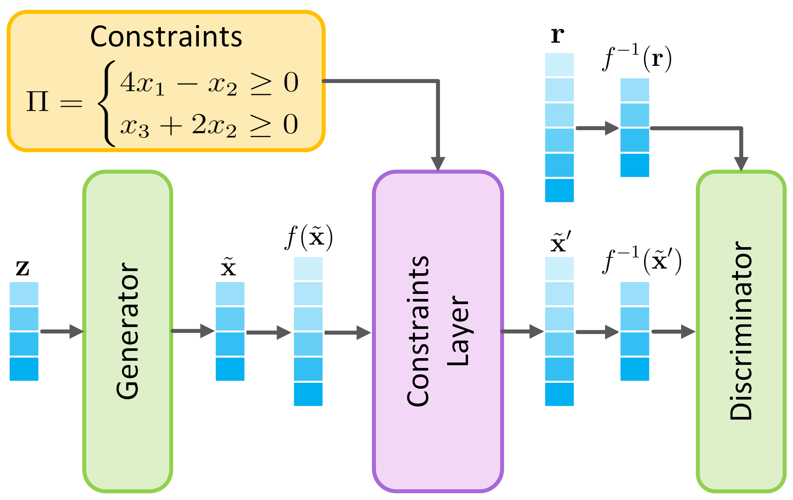

# Constrained DGMs

This repository contains the code related to our publications "**How Realistic Is Your Synthetic Data? Constraining Deep Generative Models for Tabular Data**", which was accepted for publication at ICLR 2024, and its extended journal version titled "**Constrained Deep Generative Models for Realistic Synthetic Tabular Data**". 

Deep Generative Models (DGMs) have been shown to be powerful tools for generating tabular data. 
However, they fail to comply with constraints that encode essential background knowledge on the problem at hand, which is needed to generate realistic synthetic data.
In our paper, we address this limitation and show how DGMs for tabular data can be transformed into **Constrained Deep Generative Models (C-DGMs)**, whose generated samples are guaranteed to be compliant with the given constraints. 
This is achieved by automatically parsing the constraints and transforming them into a Constraint Layer (CL) seamlessly integrated with the DGM, as shown below.


{height=240px width=400px}


## Requirements
````
conda create -n "cdgm" python=3.10 ipython
conda activate cdgm
conda install pytorch torchvision torchaudio cpuonly -c pytorch
pip install autograd
pip install wandb
pip install synthcity
````
For GOGGLE please create a separate python environment based on google_env.txt

Additionally, we are using WandB for tracking the results. You need to set up your account there

## Data
To download the datasets as they were used in this paper please use the following link:
- https://doi.org/10.6084/m9.figshare.26830996.v1
  
Place train, val and test splits in the approriate dataset folder under data directory.
  
Please refer to the appendix of our paper for more details on the datasets we used, their original source and pre-processing if any.


## Training

Models are trained using the following command structure:

````
python main_<model>.py <use_case> [arguments]
````
Supported models are [WGAN, TableGAN CTGAN, TVAE, TTVAE, GOGGLE] and use_case ["url","wids","lcld","heloc","news","faults"]

General cross model arguments include:
| Argument | Type | Default | Choices / Description |
| :--- | :--- | :--- | :--- |
| `--seed` | `int` | `7` | Random seed for reproducibility. |
| `--version` | `str` | `unconstrained` | `unconstrained`, `constrained`, `postprocessing` |
| `--label_ordering` | `str` | `random` | `random`, `corr`, `kde`, `wasserstein`, `jsd`, `causal` |
| `--wandb_project` | `str` | `c-dgm_test` | Weights & Biases project name. |
| `--wandb_mode` | `str` | `online` | `online`, `disabled`, `offline` |
| `-e`, `--epochs` | `int` | `300` | Number of training epochs. |
| `--batch_size` | `int` | `500` | Batch size |
| `-n`, `--num-samples` | `int` | `None` | Number of rows to sample. |
| `--save_generated_data` | `flag` | `False` | Should be set, in order to save the generated synthetic dataset to disk. |
| `--performance_evaluation` | `flag` | `False` | Should be set to run downstream performance metrics after training. |


For model dependent parameters please take a look at each main_<model>.py file.

## Post evaluation
The training script allows you to run the evaluation step for utility and detection. However To run evaluation separately using previously saved synthetic data use:

````
reeval_final.py ${use_case} ${model} ${version}
````
If you use this paper, please cite the following:
```
@inproceedings{cdgm2024iclr,
  title = "How Realistic Is Your Synthetic Data? Constraining Deep Generative Models for Tabular Data",
  author = "Mihaela Catalina Stoian and Salijona Dyrmishi and Maxime Cordy and Thomas Lukasiewicz and Eleonora Giunchiglia",
  year = "2024",
  booktitle = "Proceedings of the 12th International Conference on Learning Representations, ICLR 2024, Vienna, Austria, 7--11 May 2024",
  month = "May",
}
```

